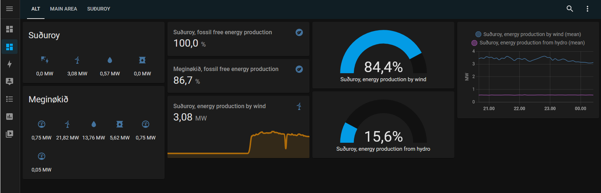

# ha-faroese-energy-production
Integration for Home Assistant that fetches energy production information from the faroese power provider SEV.
Creates a set of sensors that may be used in dashboards or used in automations.



## Installation
### Via HACKS
Add this repository to HACKS via HACKS/user defined repositories
### Manual installation
## installation
1) Create a subfolder called ha-faroese-energy-production in the .homeassistant/custom_components. 
2) Copy the contents of the repository/custom_components folder into the newly created subfolder.

## Configuration
Go to **Settings → Devices & services → Add integration**, search for
**Faroese energy production** and select one or more areas.
A set of sensors is created for each selected area.

To change the areas later, click **Configure** on the integration entry.

### Legacy YAML configuration (deprecated)
An existing `configuration.yaml` setup like the one below is imported into the UI
automatically on startup. After that, remove it from `configuration.yaml`.
```
sensor:    
  - platform: fo_energy_production    
    areas:    
      - suduroy    
      - main
      - total
```
